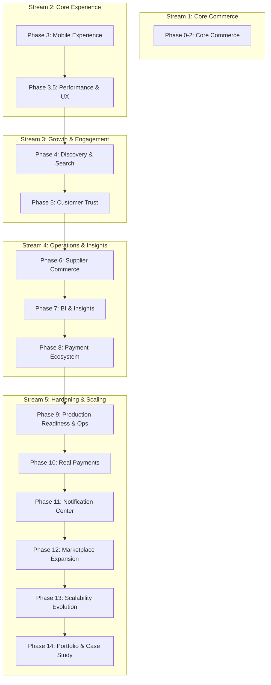

# Project Roadmap & Operating Model - Local Vendor Marketplace (v1.0.1 Frozen)

This document serves as the project's **engineering operating model** and development blueprint. It is divided into:
1. **Delivery Roadmap (Active Execution):** Milestone-based short-term sprint breakdowns, success criteria, and non-goals.
2. **Product Vision Roadmap (Long-Term Plan):** Stream-grouped phases, continuous tracks, living risk register, and showcase case studies.
3. **Engineering Workflow & Sprint Definition of Done (DoD):** The quality checklist required for every completed sprint.

---

# SECTION 1: Delivery Roadmap (Active Execution)

This delivery roadmap serves as the day-to-day directive, detailing the active phases for execution broken down into milestones.

```
Current Sprint/Active Execution Focus
------------------------------------
Phase 3: Mobile Experience (Active)
   ↓
Phase 3.5: Performance & UX Foundation (Queued)
   ↓
Phase 4: Discovery & Search (Queued)
```

## Active Phase 3: Mobile Experience

### Sprint Milestones
*   **Sprint 1: Mobile Header & Layout Shell**
    *   Transition desktop headers to touch-friendly responsive drawers.
    *   Align main navigation links and user account selectors into a bottom action bar or drawer layout.
*   **Sprint 2: Mobile Product Grid & Cards**
    *   Optimize multi-column listing grids into clean single- or double-column layouts depending on screen width.
    *   Increase hit targets for filter buttons, sorting tags, and product bookmarks.
*   **Sprint 3: Mobile Product Details & Options**
    *   Optimize image galleries for touch swipes.
    *   Design clean selection overlays for product variant dropdown selectors (size, color, weight).
*   **Sprint 4: Mobile Cart & Saved Items**
    *   Optimize quantities update selectors and removal triggers for thumb-friendly tap positions.
    *   Format cart summaries and "Save for Later" lists to eliminate horizontal scrolling.
*   **Sprint 5: Mobile Checkout**
    *   Optimize multi-step address forms and payment selectors for mobile display.

### Success Criteria
*   **Zero Horizontal Scrolling:** No element causes horizontal layout shifts below $768\text{px}$.
*   **Touch Targets:** All interactive items, inputs, and triggers maintain a height/width $\ge 44\text{px}$.
*   **Lighthouse Score:** Mobile Lighthouse Performance $\ge 90$.
*   **Cross-Browser Compliance:** Layout renders consistently on mobile Chrome (Android) and mobile Safari (iOS).

### Non-Goals
*   Dark mode implementation.
*   Tablet landscape optimization.
*   Desktop UI redesign.

---

## Queued Phase 3.5: Performance & UX Foundation

### Sprint Milestones
*   **Sprint 6: Rendering Performance Hardening**
    *   Implement memoization audits (`React.memo`/`useCallback`) and review list rendering stable key identifiers.
*   **Sprint 7: Data Fetching Optimization**
    *   Set up request deduplication, cache invalidation triggers, and optimistic updates.
*   **Sprint 8: Assets Optimization**
    *   Add responsive image rules, lazy-load assets, code split routes, and create loading skeleton states.
*   **Sprint 9: UX & Accessibility Polish**
    *   Style empty/error fallback panels with retry buttons and verify keyboard navigation.

### Success Criteria
*   **First Contentful Paint (FCP):** Mobile FCP $\le 1.8\text{s}$ on 4G throttle.
*   **Zero Duplicate API Requests:** Deduplicate simultaneous duplicate queries on initialization.
*   **Keyboard Accessible:** Full keyboard traversal on main links, buttons, and modals.
*   **Robust Fallbacks:** Product details or cart errors load explicit, friendly alert panels with reload buttons.

### Non-Goals
*   Service workers offline storage database syncing.
*   React Query migration (focus is on optimizing current Context/Axios implementation).

---

## Queued Phase 4: Discovery & Search

### Sprint Milestones
*   **Sprint 10: Browsing History & Bookmark Storage**
    *   Construct client-side local histories for recently viewed items.
*   **Sprint 11: Faceted Search & Filters**
    *   Refine query inputs with debounced checks and sidebar/overlay facet filters.
*   **Sprint 12: Rule-Based Recommendations**
    *   Introduce SQL-based basic filters matching related items.
*   **Sprint 13: Search Quality & Telemetry**
    *   Inject typo tolerance, synonyms handling, and clickstream logging triggers.

### Success Criteria
*   **Faceted Filtering:** Combined criteria updates (e.g. Price + Category + Rating) react in $\le 200\text{ms}$.
*   **Typo Tolerance:** Searches like "cloths" return correct hits matching the "Clothes" category.
*   **Clickstream Analytics:** User actions (`Product Viewed`, `Search Used`, `Recommendation Clicked`, `Wishlist Added`) are correctly logged.
*   **Business KPIs:** Search usage rate $\ge 30\%$, Recommendation Click-Through Rate (CTR) $\ge 5\%$, Wishlist conversion (items moved to cart) $\ge 15\%$, Search abandonment rate $\le 20\%$.

### Non-Goals
*   Dynamic ML-based recommendations models.
*   Full-text search engine migration (Elasticsearch/Algolia).

---

# SECTION 2: Product Vision Roadmap (Long-Term Plan)

This outlines the full lifecycle of the marketplace from foundation to scale, detailing the features, continuous tracks, and portfolio goals.

## Strategic Streams

```
  [ CORE COMMERCE ]  ➔  [ CORE EXPERIENCE ]  ➔  [ GROWTH & ENGAGEMENT ]  ➔  [ OPERATIONS & INSIGHTS ]  ➔  [ HARDENING & SCALING ]
     Phases 0 - 2          Phases 3 - 3.5             Phases 4 - 5               Phases 6 - 8               Phases 9 - 14
```

---

## Continuous Tracks (Active Across All Phases)

These tracks run in parallel to prevent development bottlenecks, technical debt, and architectural decay.

*   **Engineering Foundation (Continuous DX):** ESLint/Prettier formatting rules, Swagger API documentation, database seed/migration tools.
*   **Architecture Maintenance & Scheduled Reviews:** Dedicate time **every two phases** to remove dead code/abstractions, clean up folders, and inspect database tables.
*   **Database Evolution:** Manage SQL migrations, run integrity data repairs, optimize query indexes, and build archival logic.
*   **Testing & Quality Assurance:** Continuous write-up of unit and API integration tests as features are built, not at the end.
*   **Product Telemetry:** Instrument user clicks, catalog views, checkouts, and searches continuously.
*   **Product Validation:** Build feature flags, user feedback fields, A/B testing blocks, and monitor heatmaps.
*   **Release Management:** Enforce Semantic Versioning (SemVer), write release notes, maintain changelogs, and use git tags.

---

## Stream Phases Overview



### Stream 1: Core Commerce
*   **Phase 0–2: Core Commerce (Completed)**
    *   Variant-based inventory schema, inventory movements audit logs, order checkouts, and ratings.

### Stream 2: Core Experience
*   **Phase 3: Mobile Experience (Active Delivery)**
    *   Mobile-first layout patterns, touch-optimized elements, and responsive navigations.
*   **Phase 3.5: Performance & UX Foundation (Queued Delivery)**
    *   Lazy assets, skeleton loaders, rendering memoization audits, data fetching strategies, and accessibility checks.

### Stream 3: Growth & Engagement
*   **Phase 4: Discovery & Search (Queued Delivery)**
    *   Browsing history, recommendations, wishlist support, and search quality refinements.
    *   *AI Opportunity:* AI recommendations (personalized content filtering based on browsing behavior).
*   **Phase 5: Customer Trust & Engagement**
    *   Verified buyer badges, rating star counts, dynamic coupon codes validation at checkout, return/replacement UI timelines, and notification engine alerts.
    *   *AI Opportunity:* AI Review Summarization (aggregating ratings sentiment).
    *   *Business KPIs:* Coupon redemption rate $\ge 10\%$, Review submission rate $\ge 8\%$ of completed orders, Return/cancellation completion response latency $\le 48\text{ hrs}$.

### Stream 4: Operations & Insights
*   **Phase 6: Supplier & Admin Commerce**
    *   Supplier dashboards (revenue, stock, active orders), bulk CSV operations, package fulfillment timelines.
    *   *AI Opportunity:* AI Product Description Generator (automatic catalog draft tool for suppliers).
*   **Phase 7: Business Intelligence & Insights**
    *   Customer analytics, product views charts, inventory forecasting reports (sell-through rates, days of inventory, average inventory age), and clickstream funnel drop-off analytics.
    *   *AI Opportunity:* AI Sales Forecasting (predictive demand logs for suppliers based on historical logs).
*   **Phase 8: Mock Payment Ecosystem**
    *   Gateway simulators (success/declined/delayed), transactional history, refund pipelines, and client wallets.

### Stream 5: Hardening & Scaling
*   **Phase 9: Production Readiness & Operations**
    *   *9A — Security:* Rate limiting, Helmet, schemas input validations, secrets management, file upload validations, authorization role audits, and vulnerability scans (`npm audit`).
    *   *9B — Testing:* Expand test coverage to 80–90% using coverage reports and set up Playwright/Cypress E2E suites.
    *   *9C — Observability:* Structured logs (Winston/Pino), slow query alerts, API response timers, and `/health` endpoints.
    *   *9D — Deployment:* Docker files, CI/CD Actions, env check validators, sitemaps, robots.txt, and automated DB backups.
*   **Phase 10: Real Payments Integration**
    *   Payment provider integration (e.g., Stripe, Razorpay, PayPal) and secure webhook validators.
*   **Phase 11: Notification Center**
    *   In-app alerts, read/unread states, history, user preferences, and transactional SMS/Email gateways.
*   **Phase 12: Marketplace Expansion**
    *   Multi-vendor onboarding portals, verification, seller storefront configurations, vendor payouts, disputes, commission logs, and performance scoring.
    *   *AI Opportunity:* AI Fraud Detection (flagging anomaly transaction activities or supplier review manipulation).
*   **Phase 13: Scalability Evolution**
    *   Incremental upgrades based on profiling: async background job queues (BullMQ), caching layers (Redis), object media storage (AWS S3), and database migration (SQLite $\rightarrow$ PostgreSQL).
*   **Phase 14: Portfolio Showcase & Case Study**
    *   Architecture Decision Records (ADRs), technical doc diagrams (architecture, sequence, ER), engineering metrics (Lighthouse scores, bundle audits, security checklists), demo assets, and case study trade-off business papers.

---

# SECTION 3: Engineering Workflow & Definition of Done (DoD)

To maintain consistent repository health and code quality, every sprint milestone is subjected to the following checklist before merging into the main branch:

```
[ ] Feature Complete (Meets success criteria and handles empty/error/loading fallbacks)
[ ] Tests Passing (Unit, API, and E2E tests verified locally)
[ ] Mobile Tested (No horizontal scroll, touch target size ≥ 44px, verified on iOS & Android simulators)
[ ] Accessibility Checked (Aria labels complete, semantic landmark check, contrast verified)
[ ] Performance Checked (Lighthouse audit run, bundle check, zero duplicate API calls)
[ ] Documentation Updated (Inline comments, module README, and Swagger specification updated)
[ ] Changelog Updated (Changelog.md file updated with semantic version bump)
[ ] ADR Written (If architectural structures, schemas, or dependencies were altered)
[ ] Git Tag Created (Semantic git tags formatted: vX.Y.Z)
[ ] Demo Showcase Updated (Updated screenshots, GIF preview, or walkthrough video updated)
```

---

# SECTION 4: Living Risk Register

*Note: This is a living document to be updated continuously as new risks emerge and old risks are resolved.*

| Risk | Impact | Mitigation |
| :--- | :--- | :--- |
| **SQLite write-concurrency limits** | Medium | Only migrate database engine to PostgreSQL when performance profiling shows write-locks blocking operations. |
| **Recommendation engine quality** | Low | Start with rule-based SQL queries, then evolve to advanced ranking features. |
| **Large client bundle size** | High | Keep router code split and run build audits after every major feature. |
| **Slow admin data tables** | Medium | Implement virtualized (windowed) tables for large analytics views. |
