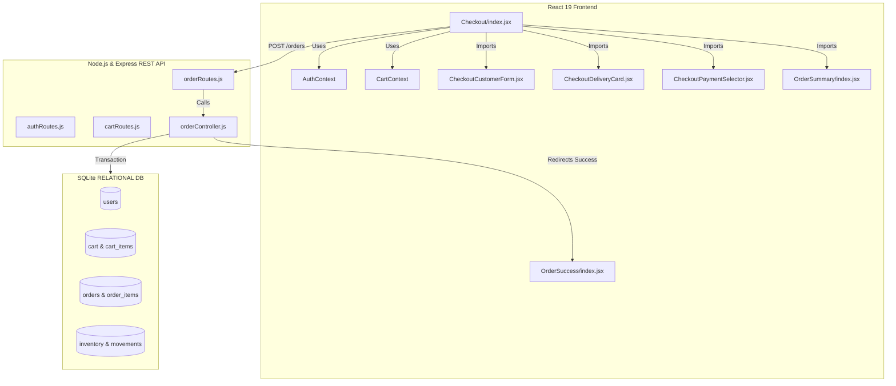
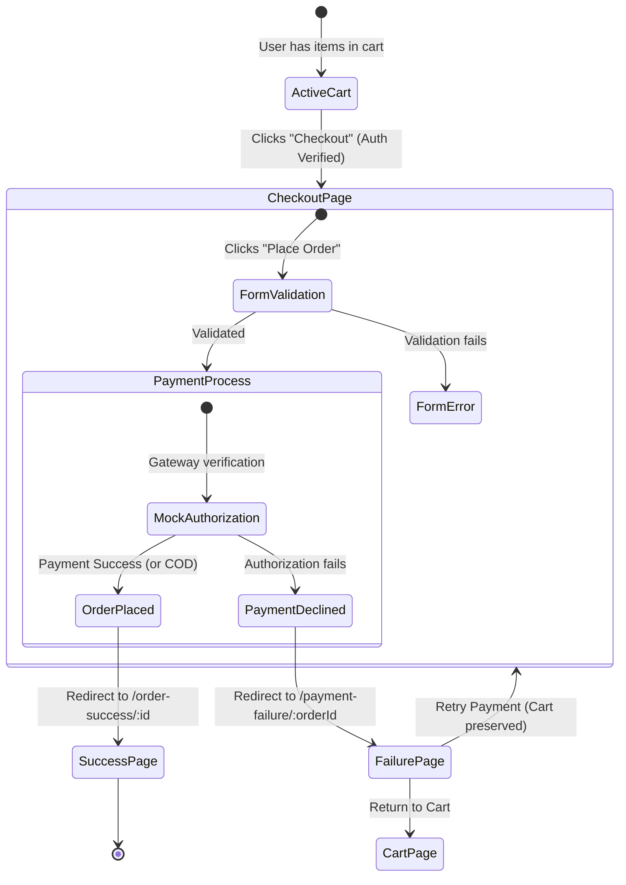

# Checkout Experience Discovery & Design Report
**Document Version:** 1.0.0  
**Phase:** Phase 2B Baseline Foundation  
**Target Architecture:** ShopCart Relational Backend & Single-Page React Frontend  

---

## Executive Summary
This document outlines the strategic roadmap, technical architecture, and user experience design for the **ShopCart Checkout Experience (Phase 2B)**. By leveraging and refactoring the existing codebase capabilities, this report establishes a low-risk, maintainable, and highly convertible checkout flow tailored to the current maturity of the Local Vendor Marketplace ecosystem.

---

## 1. Current State Analysis

### 1.1 Existing Architecture Overview



#### 1.1.1 Frontend Implementation
*   **Checkout Page Context & Routing:** Located at [Checkout/index.jsx](file:///c:/Users/hp/OneDrive/Desktop/PROJECT5/frontend/src/pages/Checkout/index.jsx). It is wrapped in a [ProtectedRoute](file:///c:/Users/hp/OneDrive/Desktop/PROJECT5/frontend/src/components/ui/ProtectedRoute/index.jsx) and requires authentication. If the cart is empty (length 0), the user is programmatically redirected back to the `/cart` page using `<Navigate to={ROUTES.CART} replace />`.
*   **Form Structure & UI Components:** 
    *   The page utilizes a standard Single-Page layout. The left column wraps the [CheckoutCustomerForm](file:///c:/Users/hp/OneDrive/Desktop/PROJECT5/frontend/src/pages/Checkout/components/CheckoutCustomerForm.jsx) (collecting Full Name, Mobile, Email, Address Line 1 & 2, City, State, Pincode, and optional notes), [CheckoutDeliveryCard](file:///c:/Users/hp/OneDrive/Desktop/PROJECT5/frontend/src/pages/Checkout/components/CheckoutDeliveryCard.jsx) (displaying delivery estimation and dynamic shipping charges), and [CheckoutPaymentSelector](file:///c:/Users/hp/OneDrive/Desktop/PROJECT5/frontend/src/pages/Checkout/components/CheckoutPaymentSelector.jsx) (rendering custom tiles for COD, UPI, and Credit Card).
    *   The right column displays the [OrderSummary](file:///c:/Users/hp/OneDrive/Desktop/PROJECT5/frontend/src/pages/Checkout/components/OrderSummary/index.jsx) containing a scrollable preview list of products, variant information, total savings calculations, subtotal breakdown, shipping costs, and the primary "Place Order" button.
*   **State Management & Data Prefill:**
    *   Authentication variables (`user`, `isAuthenticated`) are consumed from `AuthContext`.
    *   Cart information (`cartId`, `resetCart`) is consumed from `CartContext`.
    *   To expedite repeat orders, the component reads user fields from `localStorage` (`checkout_name`, `checkout_phone`, `checkout_email`, `checkout_address_line1`, etc.) on mount. If localStorage is empty, it falls back to `user.username` for the name; address fields default to empty strings.
*   **Form Validation:** Form validation is performed client-side on form submission and field change. It enforces:
    *   `name`: Required, minimum 3 characters.
    *   `phone`: Required, exactly 10 digits (digits-only).
    *   `email`: Required, valid email pattern matching `/^[^\s@]+@[^\s@]+\.[^\s@]+$/`.
    *   `addressLine1`, `city`, `state`: Required.
    *   `pincode`: Required, exactly 6 digits (digits-only).
*   **Shipping & Pricing Engine:** Calculations are driven by utility functions [pricing.js](file:///c:/Users/hp/OneDrive/Desktop/PROJECT5/frontend/src/utils/pricing.js). The shipping cost tiers are:
    *   **FREE** shipping if cart subtotal is $\ge \text{₹}1000$ or if any product in the cart has `free_shipping = 1` set in the database.
    *   Otherwise, shipping cost is:
        *   **₹20** for subtotals $\ge \text{₹}800$
        *   **₹50** for subtotals $\ge \text{₹}500$
        *   **₹80** for subtotals below ₹500.

#### 1.1.2 Backend Implementation
*   **Routing & Controller Hookup:** The endpoints are defined in [orderRoutes.js](file:///c:/Users/hp/OneDrive/Desktop/PROJECT5/backend/routes/orderRoutes.js) and handled in [orderController.js](file:///c:/Users/hp/OneDrive/Desktop/PROJECT5/backend/controllers/orderController.js). 
*   **Order Submission (`POST /orders`):** Receives `cart_id`, `name`, `email`, `address`, `phone`, `paymentMethod`, and `notes`.
*   **Database Transaction Workflow:** 
    1.  Verifies the cart exists, belongs to the authenticated user, and is marked as `active` in the `cart` table.
    2.  Pulls the list of items from `cart_items` merged with `product_variants` and `products` to inspect prices, variant availability, and available stock levels.
    3.  Performs stock level assertions (`available_stock >= quantity`). Aborts and throws an error if any item is out of stock.
    4.  Calculates final shipping amounts and totals server-side.
    5.  Generates a unique order number: `ORD-[YYYYMMDD]-[6-digit-random-seq]`.
    6.  Begins a database transaction (`BEGIN TRANSACTION`):
        - Inserts an order row into `orders`.
        - Inserts order events into `order_events` (status: `placed`).
        - Loops through cart items and inserts rows into `order_items`.
        - Decrements inventory stock records in the `inventory` table.
        - Appends changes to the `inventory_movements` log (reason: `sale`).
        - Evaluates if the new stock level drops below `reorder_level` and flags an alert in the `alerts` table if needed.
        - Deletes all item entries from `cart_items` for the current cart ID.
        - Updates the cart status to `converted` in the `cart` table.
        - Commits the transaction (`COMMIT`). If any step fails, database state is restored (`ROLLBACK`).
    7.  Launches an async email notification (`sendOrderEmail`) to report order details to the customer.

---

### 1.2 Reusable Elements Catalog
The codebase contains a robust library of UI blocks and helper utilities that will be preserved to maintain styling consistency:

| Category | Component / Utility | File Reference | Reuse Role |
| :--- | :--- | :--- | :--- |
| **Primitives** | `InputField` | [InputField/index.jsx](file:///c:/Users/hp/OneDrive/Desktop/PROJECT5/frontend/src/components/ui/InputField/index.jsx) | Renders accessible text inputs, textareas, and select elements. |
| **Primitives** | `Button` | [Button/index.jsx](file:///c:/Users/hp/OneDrive/Desktop/PROJECT5/frontend/src/components/ui/Button/index.jsx) | Handles standard and loading-state button actions. |
| **Primitives** | `Spinner` | [Spinner/index.jsx](file:///c:/Users/hp/OneDrive/Desktop/PROJECT5/frontend/src/components/ui/Spinner/index.jsx) | Displayed during data fetching and transaction processing. |
| **Layouts** | `PageLayout` | [PageLayout/index.jsx](file:///c:/Users/hp/OneDrive/Desktop/PROJECT5/frontend/src/components/layout/PageLayout/index.jsx) | Handles standard page wrappers, including headers and footers. |
| **Checkout UI** | `CheckoutCustomerForm` | [CheckoutCustomerForm.jsx](file:///c:/Users/hp/OneDrive/Desktop/PROJECT5/frontend/src/pages/Checkout/components/CheckoutCustomerForm.jsx) | Used to collect contact information and custom notes. |
| **Checkout UI** | `CheckoutDeliveryCard` | [CheckoutDeliveryCard.jsx](file:///c:/Users/hp/OneDrive/Desktop/PROJECT5/frontend/src/pages/Checkout/components/CheckoutDeliveryCard.jsx) | Renders shipping charges and estimated delivery timelines. |
| **Checkout UI** | `CheckoutPaymentSelector` | [CheckoutPaymentSelector.jsx](file:///c:/Users/hp/OneDrive/Desktop/PROJECT5/frontend/src/pages/Checkout/components/CheckoutPaymentSelector.jsx) | Renders selectors for payment options. |
| **Checkout UI** | `OrderSummary` | [OrderSummary/index.jsx](file:///c:/Users/hp/OneDrive/Desktop/PROJECT5/frontend/src/pages/Checkout/components/OrderSummary/index.jsx) | Displays cart items preview and subtotal details. |
| **Checkout UI** | `CheckoutTrustBar` | [CheckoutTrustBar.jsx](file:///c:/Users/hp/OneDrive/Desktop/PROJECT5/frontend/src/pages/Checkout/components/CheckoutTrustBar.jsx) | Displays safety badges below the order action buttons. |
| **Utilities** | `pricing` | [pricing.js](file:///c:/Users/hp/OneDrive/Desktop/PROJECT5/frontend/src/utils/pricing.js) | Standardized shipping rates calculation. |
| **Utilities** | `formatters` | [formatters.js](file:///c:/Users/hp/OneDrive/Desktop/PROJECT5/frontend/src/utils/formatters.js) | Standard currency and text formatting utilities. |

---

### 1.3 Gaps & Technical Constraints

#### 1.3.1 Frontend Gaps
1.  **Static Address Input:** There is no database-backed saved address selection. The user must type their address manually every time or rely on values cached in the client browser's local storage.
2.  **No Dropdown for States:** The State field is a plain text box. This allows spelling typos (e.g., "Mhrstra" instead of "Maharashtra"), complicating shipping routing and analytics.
3.  **Lack of Mock Payment Integration:** The checkout page has UI blocks for UPI and CARD payments, but they are disabled with "Coming Soon" badges. Clicking them does nothing.
4.  **No Payment Failure / Retry Interface:** If a backend submission fails, the page shows a basic banner error. There is no route or UI to handle checkout recovery, payment failure states, or card decline retries.
5.  **Unused Imports:** The main [Checkout page](file:///c:/Users/hp/OneDrive/Desktop/PROJECT5/frontend/src/pages/Checkout/index.jsx) imports `CheckoutTrustBar` but does not render it directly (it is instead rendered inside `OrderSummary`), leaving dead code imports in the entry point.

#### 1.3.2 Backend Gaps
1.  **No Profile or Address APIs:** The user schema defined in [01_create_new_schema.sql](file:///c:/Users/hp/OneDrive/Desktop/PROJECT5/backend/migrations/01_create_new_schema.sql) contains columns for addresses (e.g., `address_line_1`, `address_line_2`), but the REST API exposes no route for customers to read or write profile info or address histories.
2.  **Single-Address Schema Limitation:** Since address columns are flat fields in the `users` table, a user is limited to storing only one address.
3.  **Mock Payment Gateways missing:** The backend validates payment methods against `['Cash', 'COD', 'UPI']` and maps card transactions to COD flags. There is no transaction validation layer.

#### 1.3.3 Technical Constraints
*   **Database Engine (SQLite):** Per [ADR-001](file:///c:/Users/hp/OneDrive/Desktop/PROJECT5/DECISIONS.md#L7-L20), ShopCart uses SQLite, which uses file-level locking for writes. High checkouts concurrency will result in database busy states. Any database changes must minimize lock-holding durations.
*   **State Management (React Context):** Per [ADR-002](file:///c:/Users/hp/OneDrive/Desktop/PROJECT5/DECISIONS.md#L23-L37), React Context is used for global state management. It lacks request deduplication and cache invalidation. Re-renders will occur in all consumer components when context objects change.

---

## 2. Recommended Checkout Flow

We evaluate four checkout patterns against the architectural requirements of the ShopCart platform:

### 2.1 Checkout Pattern Evaluation

| Feature / Metric | Single Page Checkout | Multi-Step Checkout | Accordion Checkout | Wizard Checkout |
| :--- | :--- | :--- | :--- | :--- |
| **UX & Funnel Conversion** | **High** (All fields visible, reduces cognitive load, minimal interaction friction) | **Medium** (Splits steps, but hides totals, leading to abandonment at later steps) | **Medium** (Clean layout but requires repeated page expansions and scrolling) | **Low** (Creates rigid tab flows that restrict cross-field corrections) |
| **Mobile Adaptability** | **High** (Requires responsive vertical stacking and sticky action buttons) | **High** (Presents short screens suitable for mobile viewports) | **Medium** (Expanded segments can cause layout overflow on smaller viewports) | **Low** (Tab selectors take up excessive horizontal space) |
| **Complexity** | **Low** (Simple forms grid; state is centralized in a single React parent component) | **High** (Requires complex multi-step page routing or tab-state managers) | **Medium** (Requires tracking section toggle animations and active steps) | **High** (Requires tracking validation states across hidden fields) |
| **Database Performance** | **High** (Consolidates database updates into a single transaction payload) | **Low** (Requires saving partial drafts or maintaining state in session files) | **High** (Saves final data in one submission request) | **Low** (Often prompts premature, partial database writes) |

### 2.2 Recommendation
**Recommendation: Single Page Checkout.**  
ShopCart's existing codebase is built around a single-page layout. Retaining this layout minimizes refactoring risk while providing the highest user conversion rate. We recommend a structured two-column layout on desktop:
*   **Left Column:** Vertically stacked form sections: (1) Address Selector, (2) Delivery Speed, (3) Payment Selector.
*   **Right Column:** Sticky summary pane showing items, pricing, and the final action button.
This approach leverages the current [Checkout/index.jsx](file:///c:/Users/hp/OneDrive/Desktop/PROJECT5/frontend/src/pages/Checkout/index.jsx) layout and requires minimal adjustments to CSS grid configurations.

---

## 3. Address Management Strategy

### 3.1 Relational Address Schema
To move away from flat columns in the user profile, we will introduce a relational `addresses` table. This allows users to store multiple shipping profiles (e.g., "Home", "Work", "Store").

```
+-----------------------------------------------------------+
|                          ADDRESSES                        |
+-----------------------------------------------------------+
| address_id (PK) | user_id (FK) | label (Home/Work/Other)  |
| name            | phone        | address_line_1           |
| address_line_2  | city         | state                    |
| postal_code     | is_default   | created_at / updated_at  |
+-----------------------------------------------------------+
```

### 3.2 Address Rules & Limits
*   **Address Limit per User:** Enforce a maximum of **5 saved addresses** per customer account. This safeguards the SQLite database against spam writes.
*   **Default Address:** A boolean flag `is_default` will designate the fallback address. Setting an address as default will automatically reset the `is_default` flag for all other address records associated with that user.
*   **State Field Standardization:** Replace the text field with a select dropdown pre-populated with Indian states and union territories.
*   **Validation Rules:**
    *   *Pincode:* Match against a validated list of service areas or verify using local postal code patterns (`/^[1-9][0-9]{5}$/`).
    *   *Mobile Number:* Must be exactly 10 digits (non-digit stripping).
*   **Guest Checkout Support:** Disabled for Phase 2B. To maintain vendor accountability and reduce fraudulent orders, the system will require user authentication.

---

## 4. Delivery Strategy

We evaluate three delivery models to support local vendors and customers:

### 4.1 Delivery Mode Analysis
*   **Standard Delivery (Baseline):** Delivered within 2-4 business days. Uses ShopCart's tiered shipping rate calculation utility (Free $\ge \text{₹}1000$, otherwise ₹20/₹50/₹80).
*   **Express Delivery:** Same-day or next-day delivery. Recommended as a flat fee option (e.g., ₹150 surcharge) available only for local shipments (same-city deliveries).
*   **Store Pickup:** Customer collects the order from the vendor's retail location. Reduces shipping charges to ₹0.

### 4.2 Implementation Phases
1.  **MVP (Phase 2B):** Support **Standard Delivery** (pre-integrated) and introduce **Express Delivery** as a simple toggle that adds a flat ₹150 surcharge to the shipping calculation.
2.  **Phase 3 (Future):** Introduce **Store Pickup**. This requires a schema update to allow store address routing and requires suppliers to manage retail operating hours.

---

## 5. Payment Strategy

ShopCart's transition from cash-only transactions to automated payments is divided into three key phases:

```
[ MVP - Phase 2B ] -------------------> [ Phase 8 ] ---------------------> [ Phase 10 ]
  * COD (Fully active)                    * Mock Gateway Integration          * Production Gateways
  * Simulated UPI Flow                    * Verify Mock UPI/Card              * Real API Integrations
  * Static QR Display                     * Simulated Bank Success/Decline    * Stripe/Razorpay Webhooks
```

### 5.1 MVP (Phase 2B)
*   **COD:** Retained as the default option.
*   **Simulated UPI:** Enable the UPI selection. When clicked, it renders a mock checkout flow. On submit, it displays a mock UPI QR code container with a simulated verification delay (900ms timer) to simulate a bank check before placing the order.

### 5.2 Phase 8 (Mock Payment Ecosystem)
*   Integrate a simulated payment gateway. When checking out via UPI or Card, users are redirected to a dedicated payment verification page.
*   The page lets developers test different scenarios by providing buttons to trigger payment successes, declinations, or network timeout states.

### 5.3 Phase 10 (Production Gateways)
*   Integrate production payment APIs (such as Razorpay or Stripe).
*   Implement secure callback hooks (webhooks) to process payments asynchronously and handle payment failures gracefully.

---

## 6. Order Review Page

In the Single Page checkout model, the Order Review step is embedded directly into the right-hand column:

### 6.1 Order Summary Details
*   **Required Fields:**
    *   Product thumbnails, titles, sizes, and colors.
    *   Quantity and unit pricing per line item.
    *   Price Breakdown:
        *   Items Total (Sum of product MRPs).
        *   Discount/Savings (Difference between MRP and selling price).
        *   Shipping & Delivery Fees.
        *   Grand Total.
*   **Optional Fields:** Gift messages or packaging instructions (omitted for Phase 2B).

### 6.2 Trust Signals & Conversion Boosters
*   **Secure Badges:** Place the security badge group (`Secure Checkout`, `Easy Returns`, `Trusted Sellers`) below the checkout CTA.
*   **Pricing Transparency:** Remove all hidden fees. Explicitly label discounts as "Savings" in green (`var(--color-status-success)`) to highlight value.
*   **Cart Preservation:** Keep the customer's cart active in the background until the payment gateway returns a successful response code.

---

## 7. Success & Failure States

### 7.1 Checkout Funnel States



### 7.2 Success Page (`/order-success/:orderId`)
*   **Visual Indicators:** Render a green checkmark animation (`var(--color-status-success)`) alongside the order ID.
*   **Status Timeline:** Show a progress bar: `Order Received` (Active) $\rightarrow$ `Seller Processing` $\rightarrow$ `Shipped` $\rightarrow$ `Delivered`.
*   **Order Recap:** Display the items purchased, shipping address, payment method, and total paid.

### 7.3 Failure Page (`/payment-failure/:orderId`)
*   **Visual Indicators:** Render an error alert icon (`var(--color-status-error)`).
*   **Error Details:** Display a helpful error message describing why the payment failed (e.g., "Insufficient funds" or "Authentication failed").
*   **Actions:**
    *   *Retry Button:* Redirects users back to the checkout page with their form data and cart intact.
    *   *Change Payment Method:* Allows users to switch from UPI/Card to Cash on Delivery (COD) to complete the checkout.

---

## 8. Database Impact Analysis

To support the recommended checkout features, we require a new database table and minor schema modifications in SQLite.

### 8.1 Schema Migrations

```sql
-- Migration: Add Relational Address Table and Update Order Reference
PRAGMA foreign_keys = OFF;
BEGIN TRANSACTION;

-- 1. Create Addresses Table
CREATE TABLE IF NOT EXISTS addresses (
  address_id         INTEGER PRIMARY KEY AUTOINCREMENT,
  user_id            INTEGER NOT NULL,
  label              TEXT NOT NULL DEFAULT 'Home' CHECK (label IN ('Home', 'Work', 'Other')),
  recipient_name     TEXT NOT NULL,
  recipient_phone    TEXT NOT NULL,
  address_line_1     TEXT NOT NULL,
  address_line_2     TEXT,
  city               TEXT NOT NULL,
  state              TEXT NOT NULL,
  postal_code        TEXT NOT NULL,
  country_code       TEXT NOT NULL DEFAULT 'IN',
  is_default         INTEGER NOT NULL DEFAULT 0 CHECK (is_default IN (0,1)),
  created_at         TEXT NOT NULL DEFAULT (datetime('now')),
  updated_at         TEXT NOT NULL DEFAULT (datetime('now')),
  FOREIGN KEY (user_id) REFERENCES users(user_id) ON UPDATE CASCADE ON DELETE CASCADE
);

CREATE INDEX IF NOT EXISTS ix_addresses_user ON addresses(user_id);
CREATE UNIQUE INDEX IF NOT EXISTS ux_addresses_default ON addresses(user_id) WHERE is_default = 1;

-- 2. Update orders schema to link to address ID (optional, for relational integrity)
-- Note: It is safer to keep address snapshots in the orders table to prevent order history shifts 
-- when a user updates their address profile. Thus, we will retain flat address fields inside orders.

COMMIT;
PRAGMA foreign_keys = ON;
```

---

## 9. API Impact Analysis

### 9.1 New API Endpoints

#### 1. `GET /addresses`
*   **Description:** Retrieves all saved addresses for the logged-in user.
*   **Auth Required:** Yes.
*   **Response Payload:**
    ```json
    [
      {
        "address_id": 1,
        "label": "Home",
        "recipient_name": "John Doe",
        "recipient_phone": "9876543210",
        "address_line_1": "Flat 401, Sapphire Building",
        "address_line_2": "Sector 4",
        "city": "Mumbai",
        "state": "Maharashtra",
        "postal_code": "400001",
        "is_default": 1
      }
    ]
    ```

#### 2. `POST /addresses`
*   **Description:** Adds a new address to the user's profile.
*   **Auth Required:** Yes.
*   **Request Payload:**
    ```json
    {
      "label": "Work",
      "recipient_name": "John Doe",
      "recipient_phone": "9876543210",
      "address_line_1": "Giga Office Tower, Bandra",
      "city": "Mumbai",
      "state": "Maharashtra",
      "postal_code": "400051",
      "is_default": false
    }
    ```

#### 3. `PUT /addresses/:id`
*   **Description:** Modifies an existing address record.
*   **Auth Required:** Yes.

#### 4. `DELETE /addresses/:id`
*   **Description:** Deletes a saved address.
*   **Auth Required:** Yes.

#### 5. `POST /payments/verify`
*   **Description:** Verification endpoint for mock payments.
*   **Auth Required:** Yes.
*   **Request Payload:**
    ```json
    {
      "order_id": 101,
      "payment_method": "UPI",
      "simulated_status": "success"
    }
    ```

---

## 10. UI Component Reuse

We will reuse existing design system primitives and components to accelerate implementation:

```
[ ShopCart Design System Tokens ]
   └── variables.css (Deep Dark Surfaces, Indigo Primary theme)
        ├── InputField (Base input wrapper)
        │    └── REUSED in Address Forms & Notes
        ├── Button (Base loading actions)
        │    └── REUSED for "Place Order" & "Retry" CTAs
        └── CheckoutCustomerForm / CheckoutPaymentSelector
             └── REUSED with updated API hooks & click states
```

---

## 11. Risks & Mitigation Strategies

### 11.1 Concurrency Lockout (SQLite Limitation)
*   **Risk:** High write concurrency during promotional campaigns can lock the database file, causing order placement requests to fail.
*   **Mitigation:** Keep database transactions short. Avoid making network calls or running slow computations (like sending emails) inside the database transaction block. Perform these tasks asynchronously after the transaction commits.

### 11.2 UI Out-of-Sync Errors
*   **Risk:** Users might submit an order for an item that just went out of stock, resulting in a database mismatch.
*   **Mitigation:** Verify inventory levels within the database transaction block. If stock is insufficient, abort the transaction and return a clear out-of-stock message to the client.

### 11.3 LocalStorage Security Risks
*   **Risk:** Storing user addresses in client-side `localStorage` can expose contact information on shared devices.
*   **Mitigation:** Move address storage to the backend database. Clear checkout values from `localStorage` once the database address management APIs are fully integrated.

---

## 12. Recommended Implementation Order

To ensure a structured rollout, we recommend dividing the checkout implementation into five milestones:

```
[ Phase 2B.1: Address APIs ] ──> [ Phase 2B.2: Address Selection UI ] ──> [ Phase 2B.3: Payment Simulator ] ──> [ Phase 2B.4: Failures & Retries ] ──> [ Phase 2B.5: E2E Hardening ]
```

### Phase 2B.1: Address Database & API Implementation
*   Create migrations for the `addresses` table.
*   Implement address controllers (`GET`, `POST`, `PUT`, `DELETE`).
*   Write unit and integration tests for the new API endpoints.

### Phase 2B.2: Address Selection Interface
*   Create the saved address cards view on the checkout page.
*   Build an "Add/Edit Address" modal utilizing the existing [InputField](file:///c:/Users/hp/OneDrive/Desktop/PROJECT5/frontend/src/components/ui/InputField/index.jsx) component.
*   Integrate a dropdown list for the State field.

### Phase 2B.3: Payment Simulator Integration
*   Enable UPI and CARD options in the payment method selector.
*   Create a payment simulation modal that allows testing different checkout outcomes (Payment Success, Insufficient Funds, Timeout).
*   Add a loading spinner to simulate payment processing.

### Phase 2B.4: Payment Failure & Retry Flow
*   Create the `/payment-failure/:orderId` page.
*   Ensure the checkout form retains user inputs when redirecting to and from the failure page.
*   Implement a "Retry Payment" workflow that preserves cart items in the user session.

### Phase 2B.5: E2E Hardening & Code Cleanup
*   Verify the checkout flow on mobile viewports. Ensure touch targets are at least 44px and layouts display without horizontal scroll.
*   Delete the legacy [CheckoutForm directory](file:///c:/Users/hp/OneDrive/Desktop/PROJECT5/frontend/src/pages/Checkout/components/CheckoutForm/) and clean up unused code imports.
*   Run the E2E verification test suite.
